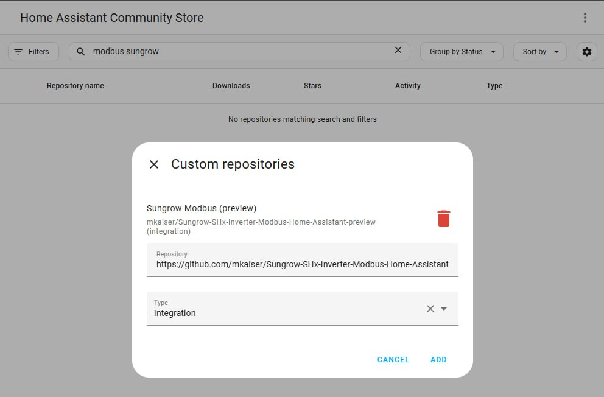
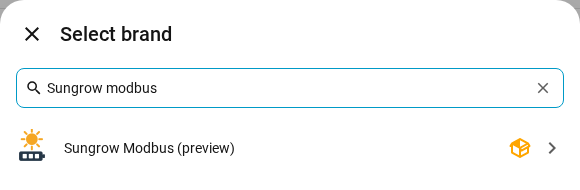
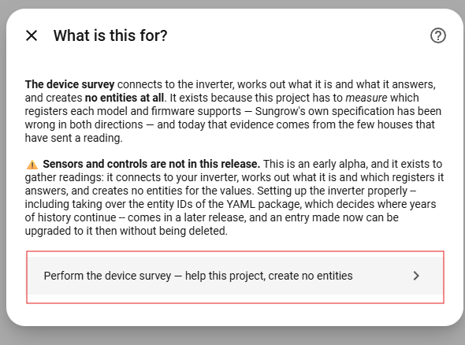
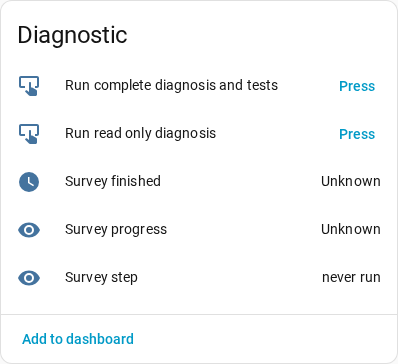

# Capability surveys

Which registers a Sungrow installation actually answers varies by model,
wiring, transport and firmware, so the integration's capability model is
built from surveys of real machines. Published surveys are in
[`results/`](results/); [devices-wanted.md](devices-wanted.md) says which
devices are missing and what each would settle.

## Contributing your device survey

Any model is welcome, an RS, MG, T-series, wallbox, SBR or Logger above all.
Send the result to
[the survey issue](https://github.com/mkaiser/Sungrow-SHx-Inverter-Modbus-Home-Assistant/issues/786).
Two ways to run it:

### 1. In Home Assistant, with the preview integration

1. In HACS → ⋮ → *Custom repositories*, add
   `https://github.com/mkaiser/Sungrow-SHx-Inverter-Modbus-Home-Assistant-preview`
   as type *Integration*, download it and restart Home Assistant
   ([the whole guide](../doc/installing_a_preview.md)).

   

2. *Settings → Devices & services → Add integration*, search for
   *Sungrow Modbus (preview)*.

   

3. Choose **Perform the device survey**.

   

4. On the device page, press **Run read only diagnosis**, or **Run complete
   diagnosis and tests** to add the
   [control test](#it-reads-and-writes-only-if-you-say-yes). Then download
   the document from the notification or with **Download diagnostics**.

   

### 2. From a terminal

1. Get this folder, either with git, which fetches only `device-survey/`:

   ```bash
   git clone --depth 1 --filter=blob:none --sparse --branch proper-ha-integration https://github.com/mkaiser/Sungrow-SHx-Inverter-Modbus-Home-Assistant.git
   cd Sungrow-SHx-Inverter-Modbus-Home-Assistant
   git sparse-checkout set device-survey
   cd device-survey
   ```

   or without git: *Code → Download ZIP* on the `proper-ha-integration`
   branch, unpack it and open the `device-survey/` folder inside.

2. Run, from inside it, and follow the questions:

   ```bash
   scripts/survey.sh            # Linux, macOS
   scripts\survey.cmd           # Windows, or double-click it
   ```

Add the address if you know it: `scripts/survey.sh 192.168.1.50`. The
launcher fetches Python and the library through
[uv](https://docs.astral.sh/uv/) (asking before it installs uv) and changes
nothing else; after that the survey talks only to your network and publishes
nothing. It finds the devices, a wallbox on its own address included, asks a
few questions no register can answer, reads for 5 to 40 minutes, and prints
which file to send.

**Stop anything else polling the inverter first**, if you can: a Sungrow
accepts very few connections, and a second reader makes registers look
broken. Dropped connections in the output are normal; the survey reconnects.

### It reads, and writes only if you say yes

The survey reads your inverter and writes nothing to it — unless you ask for
the **control test**: in Home Assistant by pressing **Run complete diagnosis
and tests**, in a terminal by answering yes to the last question. That test
checks that the integration writes each setting at the right scale, and to do
it, after the reading is finished, it:

* forces the battery to charge and to discharge, for less than a minute;
* switches feed-in limitation on for about a minute, where it is off;
* cuts PV generation for about half a minute, where the inverter has the
  register for it (31211), and lets it run again;
* stops the inverter and starts it again: 3 to 4 minutes without PV
  production in daylight, over 6 at night, and anything on the backup output
  loses power.

Every setting it touches is saved to a snapshot file first, and put back and
read back at the end, whatever happens. If something cannot be put back the
run says so, keeps the file, exits 5 and prints the one command that
restores it:

```bash
scripts/survey.sh control 192.168.1.50 --restore <the file it names>
```

#### In Home Assistant, opt out of what you do not want

The button is your yes. The restart, the feed-in limitation and the PV cut
are each **on unless you switch them off**, under *Settings → Devices &
services → Sungrow Modbus (preview) → Configure → What the control write test
may do* ([every option there](../doc/integration_options.md)). Switch them
off **before** pressing the button; what you switch off stays off. With all
three off, the test still forces the battery and checks every setting's
scale, and the document records which checks it skipped because you said
no.

Leaving them on answers the open questions: the PV cut is how your firmware
gets the **Cut PV generation** switch (it needs 500 W of PV, so it skips
itself at night), and the restart puts your model's recovery time on record.

#### In a terminal, the default is no

The default answer is no. Press Enter, or run it with nobody at the
keyboard, and nothing is written. A survey that ran without it prints the
command that runs it later, into the document just written:

```bash
scripts/survey.sh control <host> --port 502 --unit 1 --merge-into <survey-file>.json
```

`survey.sh control ...` hands everything after `control` to
`sungrow_control_test.py`: `--dry-run` resolves the whole plan and writes
nothing, `--restore <snapshot>` puts back a run that died halfway,
`--start-only` starts a stopped inverter, `--export-scale` asks how this
firmware writes register 13074 with one write that changes nothing.

### What a run writes, and what to send

Two files, both in `device-survey/` — the folder above the launchers,
whichever way the survey was started. Inside a checkout `.gitignore` covers
both by name.

| File | What is in it |
| --- | --- |
| `<label>.json` — **send this one** | What your inverter is and what it answered. The serial is replaced by a stand-in starting `anon-`, and the address is left out except, if you allow it, its last two octets. It does carry the date and time of the reading and the live values read at that moment — power, battery, meter |
| `sungrow-scan-<date>-<time>.log` — **keep this one** | The transcript: everything the run printed, including the **real** serial and addresses. Useful to send *privately* if something went wrong. Never published |

A wallbox at its own address adds a third, `<model>-<reporter>-<stand-in>-wallbox-tls.json`,
to send as well. A control test that could not put everything back leaves a
fourth, `<time>-snapshot.json`, which `--restore` takes and removes.

No un-redacted copy of the document is written, so `--save
device-survey` cannot put a real serial here whatever it is asked.
Look at the file, then attach it to [the survey issue](https://github.com/mkaiser/Sungrow-SHx-Inverter-Modbus-Home-Assistant/issues/786) if you are
happy to.

### What the last line means

The last line of the run is the exit code and its sentence, because a pasted
transcript loses `$?`. Over several devices the worst one wins.

| Code | Means |
| --- | --- |
| 0 | the scan completed and every device produced a whole document |
| 1 | nothing was collected — no device found, or the link went before the first read. Try giving the address; port 502 is usual, a Logger uses 503 |
| 2 | this cannot run here — an address or `--address-tail` that cannot be used |
| 3 | collected, but something the filename is built from did not read (the device type, the output type, the serial or the readings), so the name under-claims. Worth a second run, and worth sending anyway |
| 4 | collected, but the reported transport contradicts the measurement. Settle that before publishing |
| 5 | the control test left something changed. Run the `--restore` line it printed; it is safe to repeat |

Without the control test nothing here changes anything on your inverter, so
re-running is always safe.

### The questions, and the command that repeats them

In order: whether anything else is polling the inverter, its unit id (only
where it matters), how the reading reaches it, whether a Modbus proxy is in
the path, whether a non-Sungrow inverter shares the meter, whether the last
two octets of the address may be published, who to credit, a comment, the
battery (only where the registers cannot settle it), and last the control
test. A wallbox at its own address is asked three: the address, who to
credit, and a comment.

Every question has a flag, and a flag given is a question not asked
(`scripts/survey.sh --help` lists them). Before it starts reading, the survey
prints the line that repeats the run with every answer and asks nothing —
with the real host on screen, and with `<host>` and `--address-tail` in the
document's `command_line`:

```
python/sungrow_survey.py <host> --address-tail 178.035 --unit 1 --pollers no
  --transport direct_lan --proxy no --other-inverter no --address two_octets
  --reporter mkaiser --comment '' --battery 'Pylontech Force H1, 14.4 kWh'
  --control-test no
```

An empty answer is still written (`--comment ''`), because an absent flag
means "ask". The line is rebuilt from the answers rather than copied from
`sys.argv`, since most of them were typed at prompts. `--port`, `--timeout`
and `--passes` appear only where they differ from the defaults. On a later
run `--address-tail` combines the published tail with the first two octets
of the local IPv4 route, so the survey can be repeated without the complete
address ever being in the document. Documents read before the survey existed
carry the equivalent `probe.sh capabilities <host> ...` line, which repeats
the reading but not the block read test.

### What is in `scripts/`

| File | What it is |
| --- | --- |
| `survey.sh` | the launcher on Linux and macOS |
| `survey.cmd`, `survey.ps1` | the launcher on Windows; the `.cmd` only starts the `.ps1` |
| `python/sungrow_survey.py` | the survey, start to finish. Its PEP 723 header names the library version it runs on |
| `python/sungrow_control_test.py` | the control test, the one file here that writes. The survey runs it only with your yes; `survey.sh control ...` runs it on its own |
| `python/probe.py` | the individual steps — `mdns`, `sweep`, `units`, `capabilities`, `dump` |
| `python/blocks.py` | the block read test from a terminal: which grouped read a device fails. `--client raw` uses the library's strict raw socket, which names the count a padded frame needs |
| `python/wallbox_direct.py` | finds and reads a wallbox at its own address, over TLS on port 516 |
| `python/ihomemanager_direct.py` | reads an iHomeManager or a Logger at unit 247: the iHomeManager's documented registers and the gaps between them, or a Logger's identity and the rest of its 8000 block raw; any text outside a documented string is published only as a stand-in |

`probe.py capabilities <host>` is the reading on its own, for a maintainer
who wants only that. It writes the document to the current directory, or to
`device-survey/` with a bare `--save`.

What each part of a document means, how the filename is built, and the
library the scripts run on: [reference.md](reference.md).
