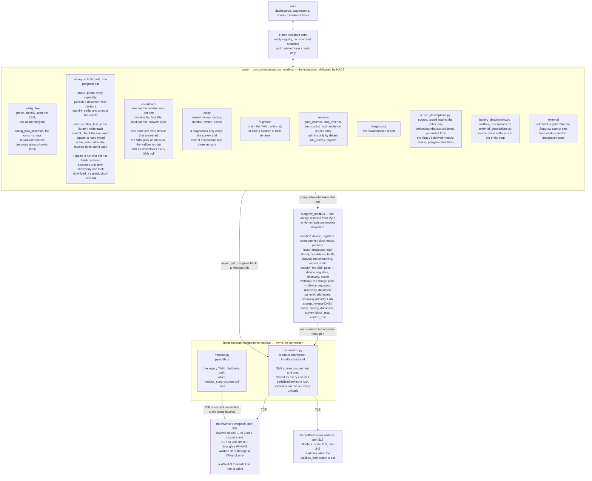
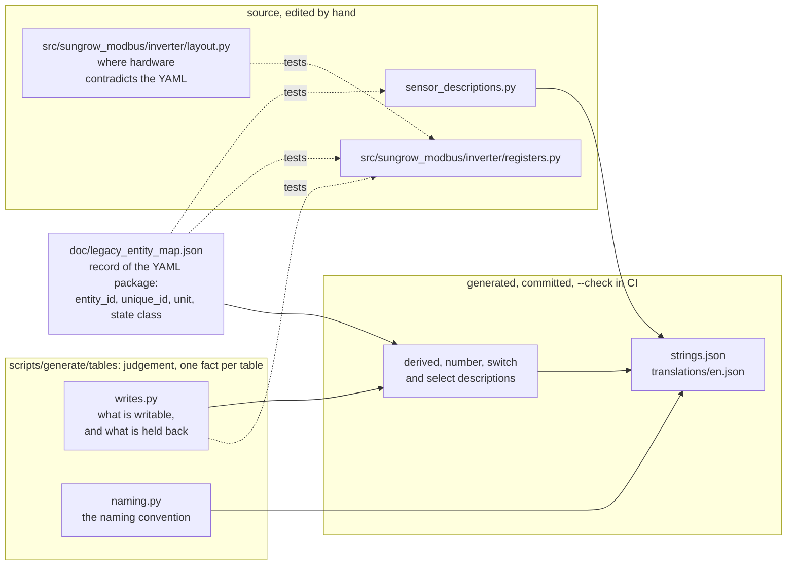

# How the pieces fit together

Six layers, and the interesting thing about them is where the boundaries are
rather than what is in each one. Two of the boundaries are load-bearing:

- **The library owns register knowledge and nothing else.** It never opens a
  socket, never imports Home Assistant, and is testable without either.
- **Home Assistant's own `modbus` integration owns the connection.** One per
  host and port, shared, serialized — which matters because a Sungrow accepts
  very few Modbus sessions at once.

## At runtime

Two backends ship inside core's one `modbus` integration, and the YAML package
rides the other one. That is not a curiosity: it is why running the YAML
package and the integration at the same time produces `Connection lost`
before a response was received, and why the integration says so in the error
rather than leaving people looking at their network.

## How the modules are cut, and why

The integration is cut along **what a piece decides**, not along size. Three
lines are worth knowing before moving anything across them.

**Decisions and data are separated where the data got big.**
`config_flow_schemas.py` holds the `voluptuous` schemas, the option lists and
the prose Home Assistant renders above them; `config_flow.py` holds the steps
that decide which of those to show. The split keeps the flow readable as flow
logic. `_alpha_placeholders` stays in `config_flow.py` although it only
produces text: it reads `ONLY_SURVEY_MODE` at call time so a test can
patch the flag there. The same instinct puts the `*_descriptions.py` files
beside the platforms that consume them.

**Anything reachable without Home Assistant lives in the library.** That is why
the control test's engine is `sungrow_modbus.control_test` and not here: it has
to run from a terminal against an inverter with no Home Assistant anywhere, and
the Home Assistant half of it is only a snapshot store, a shutdown hook, a
progress callback and the options that say what a run may do.

**One thing is polled by one coordinator, and coordinators that differ only in
a noun share a base.** `SungrowSubDeviceCoordinator` holds what the SBR pack
and the wallbox have in common -- reached through the inverter's connection,
hung off it with `via_device`, identified by *its* serial because neither
reports a usable one, and turning a `ModbusError` into an `UpdateFailed` that
names which device failed. An SBR reports no serial at all; a wallbox's own
(input 21201-21206) is shown as its `serial_number` but never used as the
identifier, and published only as a stand-in. The two subclasses are left
holding only what genuinely differs: how a model name is found, and how often
each block is worth reading.

**`PARALLEL_UPDATES` is 1 on the write platforms, and 0 everywhere else.**
Everything on one endpoint is serialized behind one connection, so two writes
issued at once queue, and the second one's timeout starts while it is still
waiting. And these registers **interlock**: `battery_min_soc` and
`battery_max_soc` are refused if they cross, so their order matters. `sensor`
and `binary_sensor` are 0 because the coordinator polls; `button` is 0
because a press schedules the run and the runner refuses a second.

**And `async_setup_entry` reads as a list of steps.** Connect and identify
(`_async_connect`); build and first-refresh the tier coordinators
(`_async_tier_coordinators`); resolve capabilities from that first poll; probe
for a pack (`_async_battery`) and a wallbox (`_async_wallbox`); register the
inverter's device so a sub-device can hang off it
(`_async_register_inverter`); assemble the runtime data and the survey runner;
drop correction entities the options no longer ask for; claim the legacy ids
(`_async_take_over_legacy_ids`); raise a repair if a control test left
registers changed (`_async_check_control_test`); and forward the platforms --
all five for an ordinary entry, button and sensor for a diagnostics-only one.
Each step is a named function that can be read on its own, which is the only
way a setup path stays reviewable as it grows.

Every option is read during setup, so the update listener reloads the entry on
any change -- except one setup never reads: the export limit's measured write
scale, which the entity stores in `data` mid-write. `_built_from` is what tells
the two apart.

## Three devices, and why the unit ids are not settings

One entry can hold three kinds of device, and **which unit id each answers
on moves with the transport**, so none of them is asked for:

| Device | Unit | Found by |
| --- | --- | --- |
| Inverter | **1**, or **2** for a cluster slave on its own LAN port | `identify()` sweeping 1 to 5. A dongle presents whatever is behind it as unit 1 regardless, so the address is only the role on a direct path |
| SBR pack | **200** direct, **2** through a WiNet-S | `battery.probe_units`, discriminating against a slave inverter — which also sits at 2 and answers a device type code where a pack does not |
| Wallbox | **3** through a WiNet-S, **248** at its own address over TLS on port 516 | `wallbox.probe_units`, reading the model *name* rather than the code or the serial. Its own address is the `wallbox_host` option, checked by the options flow before it is saved; with it set, the endpoint is not asked as well |

Each extra device gets its **own device registry entry**, hung off the
inverter with `via_device`, identified by the *inverter's* serial plus a
suffix: an SBR has no serial anywhere in its registers, and a wallbox's is
shown on its device page but published only as a stand-in. So the wallbox's device and entity ids are the same whichever path reaches it,
and moving it from the dongle to its own address keeps its history.

A wallbox never answers through the inverter's own LAN port, and its own
address speaks Modbus only inside TLS on 516, with no port 502 -- so the
config flow's sweep of 502 and 503 does not find it. Sub-devices are probed
again whenever the entry's endpoint changes, so a move from a dongle to a
cable keeps the pack and loses a dongle-carried wallbox unless `wallbox_host`
points at it; the move step says so before it happens.

The pack is polled on the inverter's *medium* interval. The wallbox fires on
the *fast* one and reads only its live block, refreshing identity, ratings and
settings every 30th firing (`SLOW_EVERY`).

## What one config entry is

**One inverter, reached through one endpoint** — a host and a port — plus
the devices discovered on it. That is exactly the set of devices sharing one
serialized connection, which is the only grouping that makes the contention
manageable, and it is why the config flow probes and identifies devices by
what answers rather than by unit id.

The unique id is the inverter's serial; the endpoint is the owner's choice.
Reconfigure, or Add integration finding the same serial at another address,
moves the entry there (`async_step_move`) with every entity id and its history
intact, and refuses an endpoint that answers with a different serial.

An entry is one of two modes (`CONF_MODE`). **Devices** is the integration:
entities, migration, controls. **Diagnostics only** connects, identifies and
polls, but creates only the survey and control test buttons and three survey
sensors -- enough for a device page -- and never asks the entity-id question.
It can be promoted from the options flow. While `ONLY_SURVEY_MODE` is
`True`, new entries can only be diagnostics: the menu offers only the survey
and says why, and the promotion toggle is greyed.

## At build time

The inverter's register map and its sensor descriptions are source, held by
tests to the record of what the YAML package produces. A mistyped address or a
scale off by ten gives a plausible-looking wrong number, which is the failure
this project can least afford, so every field is checked against that record
rather than trusted.

A solid arrow is `scripts/generate/descriptions.py`, whose `--check` runs in CI
**and** in pytest, so a generated file cannot drift from what it was derived
from. A dotted arrow is a test: `tests/test_registers.py` holds every field of
`registers.py` to its entity-map entry — address, type, scale, word order,
poll interval — and to `layout.py`'s isolation;
`tests/test_sensor_descriptions.py` holds every sensor to the YAML entity it
replaces — legacy name and id, unit, state class, category, component; and
`tests/test_writes.py` holds the writable set to `writes.py`. So a hand edit
is free, and a hand edit that breaks one of those properties fails on its own
commit.

The tables are where judgement lives, and each records why rather than just
what: `writes.py` says why a register is exposed or held back, `naming.py`
states the convention a test then enforces, and `layout.py` carries
measurements from real hardware where the YAML turned out to be wrong about a
register's length or a block's readability.

**The battery and wallbox maps have no entity-map record.** The SBR's
registers are in an opt-in file a user copy-pastes, and the wallbox's are in
no Sungrow document at all, so `battery/registers.py`, `wallbox/registers.py`
and their description modules are checked like this:

| Hand-written | Checked against |
| --- | --- |
| `battery/registers.py` | `legacy/additional_sensors/modbus_sungrow_SBR_battery.yaml`, address and scale per field — all forty of its sensors |
| `wallbox/registers.py` | the raw words and the readings in a committed survey: the document decoder must reproduce the readings, and the components must read the same values from the same words |
| `battery_descriptions.py`, `wallbox_descriptions.py` | every `field` resolves to a real field or property; no key collides across devices |

That is the same discipline as the inverter's map: where nothing generates a
file, a test or a measurement says whether it is right.

## Why the library has no Home Assistant imports

It is a plain Python package on `modbus-connection`, so the register map, the
capability probing, the derived arithmetic and the smoothing all test without
Home Assistant and without an inverter — which is most of the test suite, and
runs in about a second. Core's `sofar` integration is the reference
implementation for this shape.

Inside it, **one subpackage per kind of device** -- `inverter/`, `battery/`,
`wallbox/` -- each holding that device's map (`registers`), the object that
reads it (`device`) and whatever only that device needs: how it is found on a
unit, its capabilities, its derived values. What spans devices sits at the
top: `addresses`, `discovery`, `dump`, the survey (`survey_document`, `survey`)
and the two tests (`block_test`, `control_test`). A change that concerns one
device belongs in its subpackage; a second device that needs it is the cue to
move it up.

It also means the library is useful on its own: `device-survey/scripts/python/probe.py`
drives it directly to survey an installation, with no Home Assistant
anywhere in the process.

The survey is cut the same way. The library holds everything a capability
document is made of -- the probes, the decoded-readings algorithm, each
section's shape and the privacy rules that apply to it (`survey_document.py`,
`survey.py`) -- and prints, prompts and writes nothing. It also holds the **order** a survey
reads in, `survey.async_capability_survey`: each producer hands it a source
that knows how to collect each step -- raw from a terminal, from what the
coordinators already polled in Home Assistant -- and the library takes the
steps in one order and catches a step the link loses, so a dropped dump
costs the dump and not the document. The terminal scripts
add questions, a progress bar, a transcript and the file;
`custom_components/sungrow_modbus/survey_document.py` adds what only Home
Assistant knows: the owner's answers from the entry's options, what its own
coordinators were doing, the progress entity, and the guard on part B. A
change to what a document *says* therefore belongs in `src/`, where both
producers pick it up.

Where time enters a polled value, in `inverter/smoothing.py`, it takes the
clock as an argument rather than reading one — which is what lets a
sixty-second delay be tested without waiting sixty seconds.

## Goals

| Goal | Concretely |
| --- | --- |
| **Backwards compatibility** | An existing user keeps their `entity_id`s, so history, dashboards, automations and InfluxDB carry on. The default for anyone with a YAML installation |
| **Migration forward** | Modern device-scoped ids carry recorder history *and* long-term statistics, with no reset or spike on the Energy dashboard |
| **Migration backwards** | Reversible both ways; an occupied target id is archived, never deleted |
| **Honest backups** | The guide says what a backup covers: SQLite yes; MariaDB, PostgreSQL and InfluxDB no |
| **Dashboards** | The Energy dashboard from known entities; a generated Lovelace dashboard on request |
| **Third-party inverters** | A foreign inverter behind the same meter is added back into the load figure |
| **Auto detection** | The user supplies a host, not a topology. Unknown devices are reported, not dropped |
| **Every Sungrow Modbus device** | Inverter, wallbox, SBR and SBH, iHomeManager, Logger, sharing one serialized connection instead of an external Modbus proxy |
| **All models, one map** | Model and wiring differences are capabilities, not forks |

Not a goal: rewriting anything outside Home Assistant. InfluxDB and Grafana
get advice and a script (`scripts/helpers/influx_migration.py`).

## Rules that do not move

- **The integration never writes a register during setup or reload**, only on
  an explicit user action. A leftover control-test snapshot becomes a repair,
  not an automatic restore.
- **Devices are identified by what answers**, never by an open port or a unit
  id.
- **Nothing is removed from an existing install silently.** Capabilities grow
  an entry by reloading; they never remove an entity.

## Decisions

- **The domain is `sungrow_modbus`** (`sungrow` is taken by another
  integration). The library is published to PyPI as `sungrow-modbus`, over
  OIDC trusted publishing with no stored token.
- **Entity ids are a choice at setup**: legacy ids for existing users, modern
  device-scoped ones for new users. Modern ids take the prefix from the device
  name: the model from the device type register or, where the search found
  more than one inverter, a name the owner gives in setup (offered: the model
  plus the role, where a direct connection could read it).
  **The options page switches an entry either way** (`migration.async_plan_id_switch`):
  towards modern ids each series moves by rename; towards legacy ids an id
  that still holds the YAML package's history continues it, and the modern
  series stays under its own id. Rows already on a target id are renamed to
  `<id>_archive` first. An id the owner chose is left alone. A YAML orphan's
  restored `unavailable` state does not count as the package running; a live
  entity on the id refuses the move.
- **Two live entries for one inverter are not offered**: both would poll a
  machine that grants very few sessions. Moving the entry keeps its ids; the
  survey's transport testimony is cleared, and sub-devices are found again.
- **The config flow says each inverter's role and how it is known.** A
  device address other than 1 is a measured slave; its partner at address 1
  is the inferred master; through dongles only battery ownership survives,
  so a role built on it is "probably" and says so.
- **The fault and alarm words are counted, not split** (`inverter.faults`,
  from V1.1.11's Appendix 4). One diagnostic sensor per word reports how
  many named flags are set and names them in an `active` attribute; `Fault
  reported` and `Alarm reported` are the problem binary sensors to automate
  on. Reserved bits are never reported.
- **The diagnostics download carries the block read test, never runs it.**
  The survey button's last measurement goes in with its time; running one
  costs minutes through a dongle, and a download is waited on.
- **The `_raw` sensors exist in legacy mode only.** Modern mode exposes the
  decoded value (a binary sensor for an `0xAA`/`0x55` mode, a ratio with its
  unit); `Derived._mode_flag` returns None for anything else.
- **A parenthetical says what a value is**: `(smoothed)` for the moving
  average, `(delayed)` for the delayed binary sensors.
- **The naming rule is per device**, and one convention is enforced by test
  (`scripts/generate/tables/naming.py`).
- **Start and stop are actions, not buttons**, with an audience set per entry
  (admins only by default); the control test has an audience of its own, and
  its restart, export limit and PV cut are each granted until the owner
  switches them off. The YAML's danger-mode toggle and automations are not
  ported.
- **The wallbox is read-only.** No manufacturer document covers its map.
- **The opt-in SBR YAML sensors are not adopted and keep no history**:
  partial adoption looks like a migration and is not one.
- **Localisation follows Home Assistant**: modern ids take the interface
  language where HA says they should; legacy ids stay English. Only English
  ships.
- **13074's write scale is measured per device** (`sungrow_modbus.inverter.export_scale`)
  and stored with the firmware it was measured on.
- **Delivery is HACS first**, through the preview channel until the merge
  into `main` ([maintainer_setup.md](maintainer_setup.md)).
- **The brand mark is original**, not Sungrow's.

## Register sources

| Device | Map from | Licence |
| --- | --- | --- |
| Inverter | `legacy/modbus_sungrow.yaml` plus Sungrow's *Communication Protocol of Residential and Small Industrial Hybrid Inverter* **V1.1.16** | MIT, this repo |
| SBR battery | `legacy/additional_sensors/modbus_sungrow_SBR_battery.yaml`, input 10740-10788 | MIT, this repo |
| SBH battery | nothing yet | — |
| iHomeManager | Sungrow's *Communication Protocol of iHomeManager* V1.0.1/V1.0.2 and [ha-modbus-manager](https://github.com/TCzerny/ha-modbus-manager)'s 53-register map | MIT (ha-modbus-manager) |
| Wallbox | [evcc `charger/sungrow.go`](https://github.com/evcc-io/evcc/blob/master/charger/sungrow.go) and our own AC22E-01 measurement, [wallbox_registers.md](wallbox_registers.md) | MIT (evcc, KevinD987); Louisbertelsmann's used with permission, for meanings only |
| Logger1000/3000/4000 | Sungrow's *Logger Communication Protocol* AW0 1.0.2.9 and [discussion #262](https://github.com/mkaiser/Sungrow-SHx-Inverter-Modbus-Home-Assistant/discussions/262) | Sungrow's document |

The inverter map is audited against V1.1.16: every addition since V1.1.2 is
read, gated by a capability where the remarks column limits it, and marked
`layer: "specification"` in the entity map because it has no legacy id.
`DEVICE_TYPES` matches Appendix 1 (`tests/test_device_types.py`), and
`family_for` classifies by model name, not code range. **SH50-125CX is named
but not supported** (ten MPP trackers against a map that stops at four).
Compare registers on **space and address together**: input and holding are
separate address spaces.
