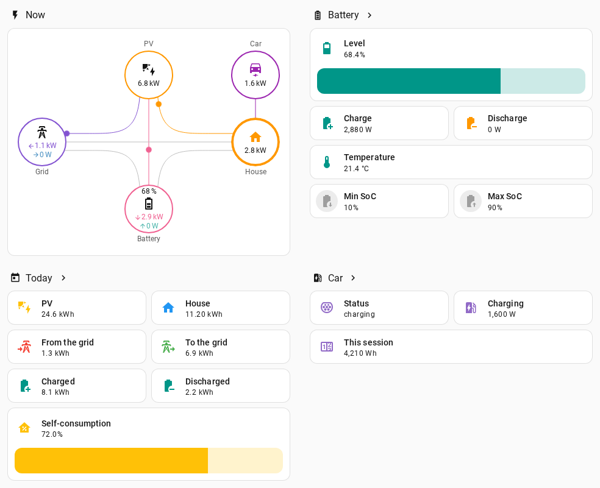

# The Sungrow dashboard

> **Still a preview**, like the integration. For the YAML package's
> dashboards, see [its guide](https://github.com/mkaiser/Sungrow-SHx-Inverter-Modbus-Home-Assistant/blob/2026-legacy/doc/dashboard.md).

The integration brings a dashboard of its own: home, energy, battery, inverter,
wallbox, controls and diagnosis. It is built in your browser from what your house has,
so it fits whatever your devices are called and whatever they are:

- **Your names are fine.** It finds each entity by what the integration knows
  about it, not by its entity ID, so IDs with a room in front, IDs kept from
  the YAML package and IDs ending in `_2` all work.
- **It shows what you have.** No battery, no Battery view; no wallbox, no
  Wallbox view; MPPTs and phases as your inverter has them. A device that is
  offline still shows, as *unavailable*.
- **Nothing to install.** It comes with the integration, not from HACS, and it
  updates with it.

It is the energy side of your house in one place. Home Assistant's own
[Energy dashboard](energy_dashboard.md) is separate and still worth setting up.

## Add it

**Settings → Dashboards → Add dashboard**, then **Sungrow Modbus** under
*Community dashboards*, and give it a name.




## The views

| View | Shows |
| --- | --- |
| **Home** | The power flow, the battery, today's energy flow, the car, and the last 24 hours. Badges at the top: the inverter's state, whether a car is plugged in, and an alarm, a fault or a running test while there is one |
| **Energy** | Home Assistant's own energy flow, where your [Energy dashboard](energy_dashboard.md) is set up; energy per day over 30 days; totals since installation |
| **Battery** | Level, charge and discharge, temperature, health, cells and modules, and 48 hours of history |
| **Inverter** | State, alarms and faults, the MPPTs, the grid phases, backup output, the device and its firmware |
| **Wallbox** | Whether a car is plugged in, status, power, this session, phases and settings, and 24 hours beside PV, export and house load |
| **Controls** | The settings the integration can write, by device. Administrators only, and locked, see below |
| **Diagnosis** | Start and stop a test, and read its results. Administrators only, see below |

A tap on a tile or a heading with an arrow opens the view with the details.

The 30-day bars come from Home Assistant's long-term statistics, which start
an hour after the integration is added; until then they say *No statistics
found*.

With **more than one inverter**, each view comes once per inverter, named
after the device. A wallbox added as an entry of its own joins the inverter's Home,
Controls and Diagnosis; with more than one inverter it has its own Wallbox,
Controls and Diagnosis tabs, since nothing says which inverter it belongs to.

## The power flow

Home shows the power between PV, house, grid, battery and car as moving dots,
with your sensors filled in. The drawing is
[Power Flow Card Plus](https://github.com/flixlix/power-flow-card-plus) by
flixlix (MIT licence), which comes with the integration: there is nothing to
install, and a copy of yours from HACS is left alone. If it cannot be loaded,
the same numbers are tiles.

Under **Today** the same circles show the day's energy, from
[Energy Flow Card Plus](https://github.com/flixlix/energy-flow-card-plus), also
flixlix's and also shipped with the integration. It draws from Home Assistant's
long-term statistics of the day's sensors, so on a new installation it reads
zero until the first hour has been recorded; it needs no Energy dashboard. If it
cannot be loaded, the day's numbers are tiles.

To have the tiles anyway, set `power_flow: tiles` in the options below. The card is
also in the card picker, as *Sungrow power flow*, for your own dashboards.

## The controls are locked

Everything on **Controls** writes to your inverter at once and stays as set.
So the view is for administrators only, and it is locked until you **hold it
for 2 seconds**: you can read every value, but a tap changes nothing. The whole
view then unlocks for 60 seconds and locks again by itself, or at once with
**Lock**.


The unlock is per browser tab: unlocking on your phone does not unlock the
wall tablet. It is a guard against a misclick, not an access control; who may
change anything at all is still each account's administrator setting, and
start, stop and the capability test stay under **Configure → Permissions**
([integration_options.md](integration_options.md)).

## Diagnosis

**Run** starts what *Mode* says. *Read-only* changes nothing; the extended
tests write settings, read them back and put everything back. **Start** and
the clear buttons are behind the lock and still under **Configure →
Permissions**; **Stop** never is.

**Results** is a checklist of every check in plain words, with a mark for how
it came out: passed, failed, not clear yet, waiting (and for what), or not
enforced by, or not available on, your device. A
turning mark is the check being measured. Tap a check for what was asked for and measured. *Runs* shows each
run and whether every setting was put back; open one for what it did and why it
left a check out. *Log* is what the test did step by step over the last 24
hours, and follows a run while it happens; waiting is one line an hour with a
dot for every five minutes. What the tests do is in
[capability_tests.md](capability_tests.md).

**Settings** holds what a run goes by, the same options as under **Configure**.
*Allowed tests* is behind the lock; *About your installation* (your name, how
the inverter is connected, a Modbus proxy, whether the end of its address may
be published) is not. Each is saved when you leave the field, without
interrupting a collection, and is fixed while a test runs.

The *Info* buttons lead to the integration's page and the device's.

## Options

**Edit dashboard** (the pencil) opens the dashboard's options as YAML. All of
them are optional:

```yaml
type: custom:sungrow-modbus
controls: hold            # hold (default), admin, or hidden
hold_seconds: 2           # how long to hold to unlock
unlock_seconds: 60        # how long it stays unlocked
power_flow: auto          # auto (default), or tiles
views: [home, energy, battery, inverter, wallbox, controls, diagnosis]   # which views, in which order
device_id: 0123456789abcdef0123456789abcdef               # only this inverter (or its wallbox)
```

| `controls` | The Controls view |
| --- | --- |
| `hold` | Administrators only, locked until held |
| `admin` | Administrators only, not locked |
| `hidden` | Not shown |

A device's ID is the last part of its device page's address
(**Settings → Devices & services → Devices**, then the device).

**Names.** Tiles and headings follow your profile's language; English and
German are there. The lists show the entities' own names, in Home Assistant's
system language (**Settings → System → General**), without the device's name
in front.

## Make it your own

To change cards, move them or add your own, take control: **Edit dashboard**,
the menu at the top right, **Take control**. Home Assistant then writes the
dashboard out as an ordinary one, with your house's real entity IDs, and you
edit it like any other.

A dashboard you have taken control of is yours: it no longer follows the
integration, so a battery or wallbox added later does not appear on it by
itself.

## When there is a newer version

The dashboard follows the integration's updates by itself. A browser tab left
open over an update says so and offers **Reload**.

One you took control of stays as it is. When the integration brings a newer
layout, administrators see a notice on it that says what is new:

- **Add it beside this one** makes a second dashboard and leaves yours alone.
- **Hold to replace this one** downloads yours as a file, then makes it the
  integration's again. Your own changes are then gone from it. A dashboard
  kept in YAML cannot be replaced this way.
- **Dismiss** hides the notice until the next newer layout.

A dashboard taken over from 0.1.0a50 or earlier gets no notice; add the Sungrow
dashboard again beside it.

## The lock on your own cards

The lock is a card of its own, so any dashboard can use it while the
integration is installed. Wrap a card in it:

```yaml
type: custom:sungrow-modbus-lock-card
hold_seconds: 2
unlock_seconds: 60
group: inverter           # cards with the same group unlock together
card:
  type: entities
  entities:
    - number.sh10rt_battery_max_soc
    - select.sh10rt_ems_mode
```

## Coming from the YAML package

The YAML package's *danger mode* switch did what the lock does now: it hid
the controls until switched on. The integration does not bring the switch
([integration_migration.md](integration_migration.md)); add the Sungrow
dashboard, or wrap your own controls in the lock card, instead.
