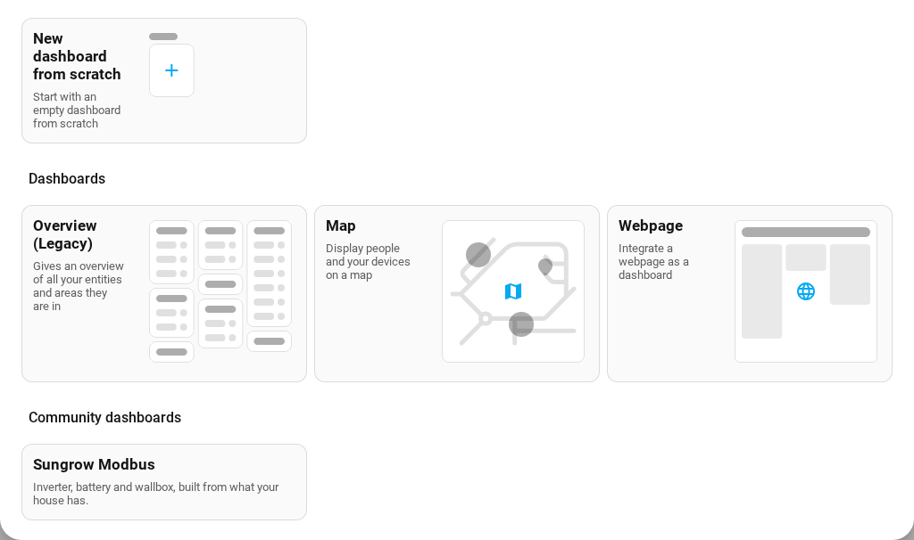
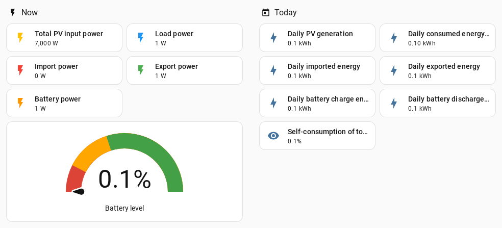
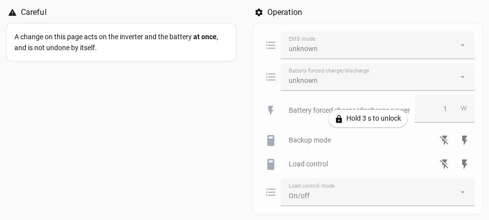

# The Sungrow dashboard

> **Still a preview**, like the integration. For the YAML package's
> dashboards, see [its guide](https://github.com/mkaiser/Sungrow-SHx-Inverter-Modbus-Home-Assistant/blob/2026-legacy/doc/dashboard.md).

The integration brings a dashboard of its own: overview, battery, inverter,
wallbox and controls. It is built in your browser from what your house has,
so it fits whatever your devices are called and whatever they are:

- **Your names are fine.** It finds each entity by what the integration knows
  about it, not by its entity ID, so IDs with a room in front, IDs kept from
  the YAML package and IDs ending in `_2` all work.
- **It shows what you have.** No battery, no Battery view; no wallbox, no
  Wallbox view; MPPTs and phases as your inverter has them. A device that is
  offline still shows, as *unavailable*.
- **Nothing to install.** It comes with the integration, not from HACS, and it
  updates with it.

It is the energy side of your house in one place. Home Assistant's own
[Energy dashboard](energy_dashboard.md) is separate and still worth setting up.

## Add it

**Settings → Dashboards → Add dashboard**, then **Sungrow Modbus** under
*Community dashboards*, and give it a name.





## The views

| View | Shows |
| --- | --- |
| **Overview** | Power now (PV, house, grid, battery), the battery level, today's energy, the last 24 hours, and energy per day over 30 days |
| **Battery** | The pack (level, health, temperature, voltage, current), its cells and modules, lifetime counters, and 48 hours of level and temperature |
| **Inverter** | Running state, alarms and faults, temperature, the MPPTs, the grid phases, backup output, firmware and lifetime totals, and a link to the device page |
| **Wallbox** | Charging status and power, session and total energy, phases and settings, and 24 hours of charging beside PV, export and house load |
| **Controls** | The settings the integration can write: operation mode, feed-in and import limits, battery limits, forced charging, discharge schedules, wallbox charging. Locked, see below |

The 30-day bars come from Home Assistant's long-term statistics, which start
an hour after the integration is added; until then they say *No statistics
found*.

With **more than one inverter**, each view comes once per inverter, named
after the device.

## The controls are locked

Everything on **Controls** writes to your inverter at once and stays as set.
So the view is for administrators only, and each section is locked until you
**hold it for 3 seconds**. The whole view then unlocks for 30 seconds and
locks again by itself, or at once with **Lock**.



The unlock is per browser tab: unlocking on your phone does not unlock the
wall tablet. It is a guard against a misclick, not an access control; who may
change anything at all is still each account's administrator setting, and
start, stop and the capability test stay under **Configure → Permissions**
([integration_options.md](integration_options.md)).

## Options

**Edit dashboard** (the pencil) opens the dashboard's options as YAML. All of
them are optional:

```yaml
type: custom:sungrow-modbus
controls: hold            # hold (default), admin, or hidden
hold_seconds: 3           # how long to hold to unlock
unlock_seconds: 30        # how long it stays unlocked
views: [overview, battery, inverter, wallbox, controls]   # which views, in which order
device_id: 0123456789abcdef0123456789abcdef               # only this inverter (or its wallbox)
```

| `controls` | The Controls view |
| --- | --- |
| `hold` | Administrators only, each section locked until held |
| `admin` | Administrators only, not locked |
| `hidden` | Not shown |

A device's ID is the last part of its device page's address
(**Settings → Devices & services → Devices**, then the device).

**Names.** Card names are the entities' own, in Home Assistant's system
language (**Settings → System → General**), without the device's name in
front. Headings follow your profile's language; English and German are
there.

## Make it your own

To change cards, move them or add your own, take control: **Edit dashboard**,
the menu at the top right, **Take control**. Home Assistant then writes the
dashboard out as an ordinary one, with your house's real entity IDs, and you
edit it like any other.

A dashboard you have taken control of is yours: it no longer follows the
integration, so a battery or wallbox added later does not appear on it by
itself. To start over, add the Sungrow dashboard again beside it.

## The lock on your own cards

The lock is a card of its own, so any dashboard can use it while the
integration is installed. Wrap a card in it:

```yaml
type: custom:sungrow-modbus-lock-card
hold_seconds: 3
unlock_seconds: 30
group: inverter           # cards with the same group unlock together
card:
  type: entities
  entities:
    - number.sh10rt_battery_max_soc
    - select.sh10rt_ems_mode
```

## Coming from the YAML package

The YAML package's *danger mode* switch did what the lock does now: it hid
the controls until switched on. The integration does not bring the switch
([integration_migration.md](integration_migration.md)); add the Sungrow
dashboard, or wrap your own controls in the lock card, instead.
