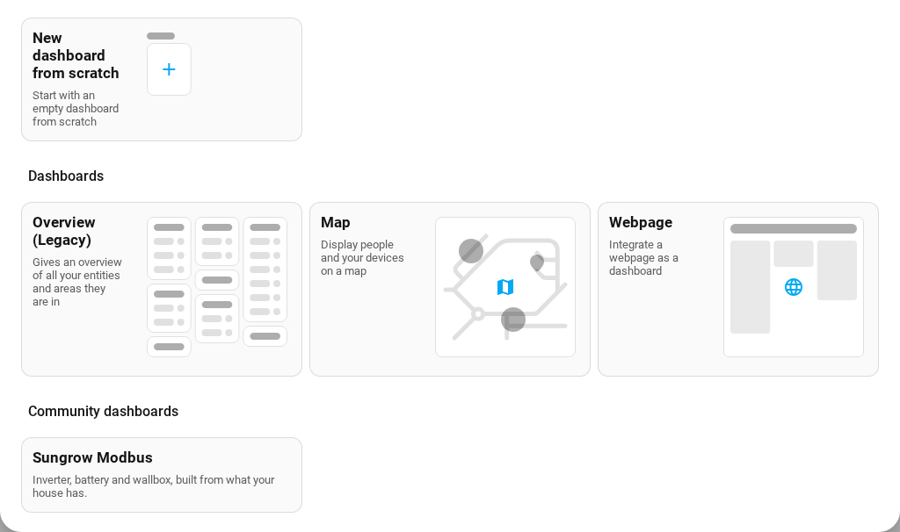
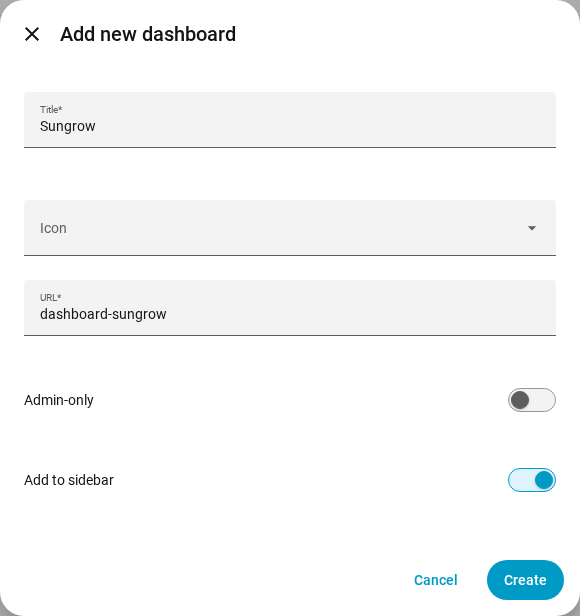
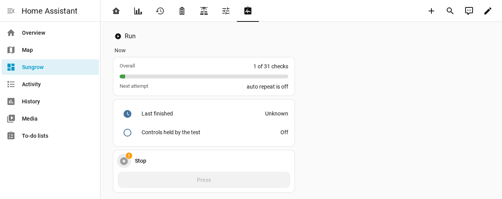
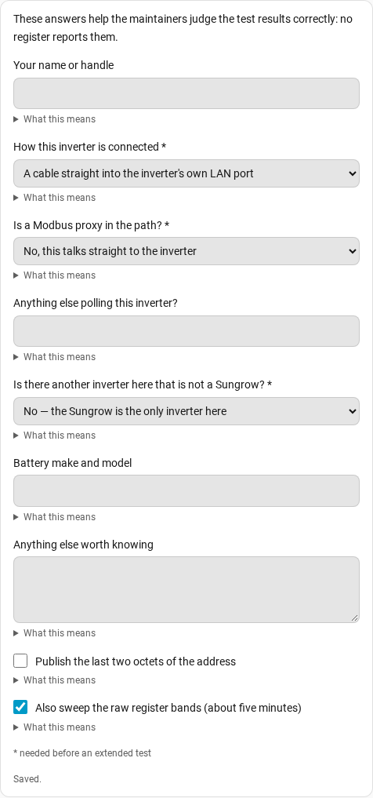
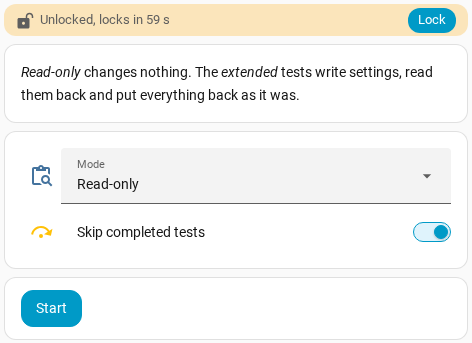
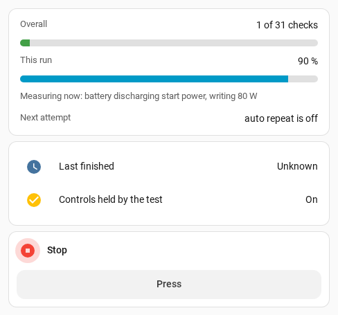
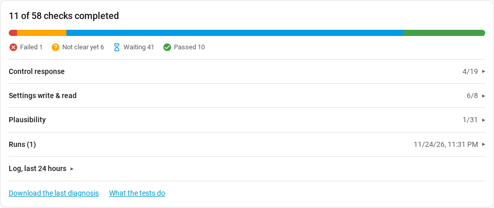

# Run the diagnosis from the Sungrow dashboard

The dashboard comes with the integration: add it once, and its **Diagnosis**
view starts a run, shows the results and gives you the file to send. You need
the [preview integration](installing_a_preview.md) set up, and an
administrator account in Home Assistant.

1. [Add the dashboard](#1-add-the-dashboard)
2. [Open the Diagnosis view](#2-open-the-diagnosis-view)
3. [Answer the questions](#3-answer-the-questions)
4. [Start the diagnosis](#4-start-the-diagnosis)
5. [Wait for the run](#5-wait-for-the-run)
6. [Download the result and send it](#6-download-the-result-and-send-it)

## 1. Add the dashboard

Go to **Settings → Dashboards → Add dashboard**. Scroll to *Community
dashboards* and choose **Sungrow Modbus**.

Give it a title, *Sungrow* for example, leave **Add to sidebar** on, and press
**Create**.

It is now in the sidebar. If *Sungrow Modbus* is not in the list, or the new
dashboard reports a *Timeout waiting for strategy element*, reload the page
(Ctrl+F5; in the app, close it and open it again): the browser still holds the
page from before the integration was installed.

## 2. Open the Diagnosis view

Open **Sungrow** in the sidebar and choose the **Diagnosis** tab, the last one:
a clipboard with a pulse line. It is there for administrators only. With more
than one inverter there is one Diagnosis tab for each.

## 3. Answer the questions

Under *Settings* at the bottom of the view is **About your installation**. No
register can answer these, and a result is worth more with them. The three
marked \* are needed before an extended test; each has an answer for every
house, *not sure* included. Each answer is saved when you leave its field.

Beside it, **Allowed tests** says what an extended test may do. Switch off what
you do not want before you start
([every test](capability_tests.md)).

## 4. Start the diagnosis

Under *Run → Start*:

1. **Hold the grey bar for 1.5 seconds** to unlock. It locks itself again after
   60 seconds.
2. Choose the **Mode**. A new installation is set to *Extended test (auto
   repeat)*, so look before you press.
3. Press **Start**.

| Mode | What it does |
| --- | --- |
| *Read-only* | Only reads. Changes nothing on your inverter |
| *Extended test (single run)* | Reads, then tests the controls once: writes each setting, checks it and puts your value back. [What that does to your house](../device-diagnosis/README.md#two-modes-read-only-or-with-capability-tests) |
| *Extended test (auto repeat)* | The same, and again on its own whenever the house can answer a check still missing (sun, a load, a battery level), until you press **Stop** |

If answers are missing, Start lists them and leads to them.

Stop anything else that polls the inverter first (the YAML package, another
Home Assistant, evcc): a Sungrow accepts very few connections.

## 5. Wait for the run

*Run → Now* shows how far it is and what it measures. The run is in the
background: you can leave the page, and a notification tells you when it has
finished. Please do not restart Home Assistant while it runs.

**Stop** ends a run early and needs no unlocking. What was measured is kept,
and everything the test changed is put back.

## 6. Download the result and send it

When a run has finished, press **Download the last diagnosis** at the foot of
*Results*. Between two runs of auto repeat the link is there too.

You get one `.json` file. Your serial number is replaced by a stand-in starting
`anon-`, and the address is left out, except its last two octets if you allowed
them. It does hold the time of the reading and the values at that moment
([what is in it](../device-diagnosis/README.md#what-a-run-writes-and-what-to-send)).
Look at it, then attach it to
[the diagnosis issue](https://github.com/mkaiser/Sungrow-SHx-Inverter-Modbus-Home-Assistant/issues/786).

**No link there?** The file is kept until Home Assistant restarts. Press
**Device page** under *Run → Info*, then **Download diagnostics** on that
page: it gives you the results too.

*Failed* or *Waiting* checks are no reason to hold the file back: they are what
the diagnosis is for. The images here are from a simulator, so your counts will
differ.

What else the view shows, *Results*, *Log* and *Clear* included:
[the dashboard guide](dashboard.md#diagnosis).
