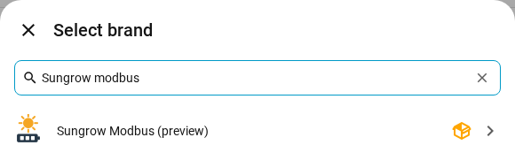
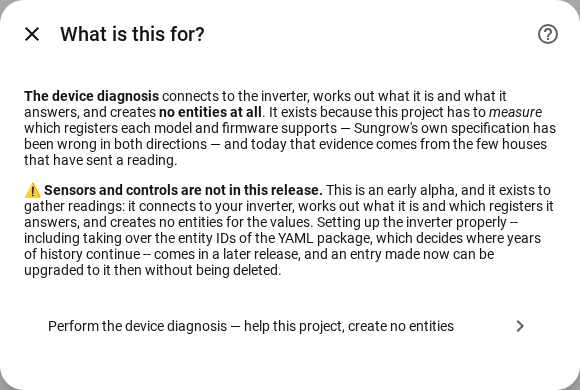
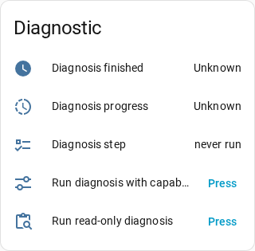

# Installing the preview

This integration is a **preview**, labelled as one in its version number, in
its name in *Add integration*, and by a notice under **Settings → Repairs**.

> **You probably want [`main`](../../../tree/main) instead**: the YAML
> package, in use by thousands of people and the only finished part of this
> project. A preview is for people who want to help find what is broken.

**A preview sets up diagnostics only.** It identifies your inverter, works out
which registers it answers and gives you a diagnosis to send back. It creates
**no sensors for the readings**. The full setup is built; it waits because
choosing whether to take over `modbus_sungrow.yaml`'s entity ids decides
where years of history attach, and that is not a thing to hand somebody in
an alpha. An entry made now can be upgraded later without losing anything.

It needs **Home Assistant 2026.11 or later**, and installs through
**Settings → Marketplace**, from a second repository, the *preview channel*:
the Marketplace reads a repository's default branch, and this one's is the
YAML package. Four steps; the third is the one people forget.

## 1. Add the preview channel to the Marketplace

**Settings → Marketplace → Add from link**:

| Field | Value |
| --- | --- |
| Repository | `https://github.com/mkaiser/Sungrow-SHx-Inverter-Modbus-Home-Assistant-preview` |
| Type | **Integration** |

Adding a repository from a link needs a read-only GitHub connection, which
the Marketplace asks for at that point; any account works. Browsing,
downloading and updating do not need it. Leave the repository's
*Pre-release* switch off: the channel publishes no releases, so there is
nothing for it to change.

## 2. Download it

Open the repository and press **Download**. The version shown is a
**commit hash**: the channel follows the development branch and publishes no
releases of its own, so the hash is what identifies your code. Quote it in
bug reports.

## 3. Restart, with internet access

The register knowledge is a separate Python package,
[`sungrow-modbus`](https://pypi.org/project/sungrow-modbus/), pinned in the
integration's `manifest.json`. On the first start Home Assistant
pip-installs it, so that start is slower and needs to reach PyPI. Without it,
setup fails with `RequirementsNotFound` and the integration does not appear:
a network problem, not a bug.

## 4. Add the integration

**Settings → Devices & services → Add integration →** search for
**Sungrow Modbus (preview)**.

Choose **Perform the device diagnosis**.

**Search my network** probes the range you confirm and identifies what
answers; or type the address (behind a WiNet-S, the dongle's). Where more than
one device answers, it lists them with each inverter's part in a cluster.
Last come a few questions no register can answer, all optional and editable
later under **Configure** ([every option](integration_options.md)).

Typing the address asks for three things:

| Field | Default | What to give |
| --- | --- | --- |
| *IP address or hostname* | none | The inverter's address as your router lists it; behind a WiNet-S, the dongle's. Reserve it in the router first. If it moves anyway, **Reconfigure** on the entry points it at the new one |
| *Port* | 502 | 502 unless somebody changed it; a Sungrow Logger uses 503 |
| *Device address* | 1 | 1 for a single inverter. The second inverter of a master/slave cluster answers on 2: give its own address, and add each inverter as its own entry |

A Sungrow accepts very few Modbus connections at once. Stop anything else
that polls it (the YAML package, another Home Assistant, another tool)
before adding the integration, or the first read fails with *could not
reach*.

## Running the diagnosis

On the device page (Settings → Devices & services → Sungrow Modbus → the
device):

Choose what to run in **Diagnosis: mode**, then press **Diagnosis: start**.
The run is in the background: you can leave the page, a notification says
when it has finished, and **Download diagnostics** then carries the document.
Please do not restart Home Assistant while a run is going.

- *Read-only* reads and never writes. The sensors beside it show progress.
- *Extended test (single run)* adds the capability test, which writes
  settings and puts every one back, checked by reading it again. Read
  [what it does, and how to opt out](../device-diagnosis/README.md#it-reads-and-writes-only-if-you-say-yes)
  first.
- *Extended test (auto repeat)* starts a capability test on its own, at most
  one in every 30 minutes counted from the press of **Diagnosis: start**,
  whenever the inverter is running and the house can answer a check still
  missing. It leaves out what earlier runs established, the
  inverter restart included. **Diagnosis: current step** says what it waits
  for and **Diagnosis: next attempt** when it looks again. It
  ends with **Diagnosis: stop**, when nothing is left to wait for, or at a
  restart.
- **Diagnosis: stop** ends a run early. What it measured is kept, and every
  value it changed is still put back; no restart is started.
- **Diagnosis: skip completed tests** decides what a single extended run
  does: on (the default), it tests only what earlier runs have not answered
  yet; off, it is the full test again. Auto repeat switches it on. A test
  whose logic an update changed counts as not answered, and runs again.

Send the document to
[the diagnosis issue](https://github.com/mkaiser/Sungrow-SHx-Inverter-Modbus-Home-Assistant/issues/786).
For a bug, see [troubleshooting](integration_help.md#troubleshooting) first,
then open an issue with **Download diagnostics** (serial and address removed)
and the commit hash the Marketplace shows.

## Updating

The Marketplace offers an update whenever the channel moves; a commit that
changes nothing you install does not notify you. Press **Update**, then restart: Home
Assistant installs the library version the new pin names. The entry, its
entities and their history survive.

## Going back

1. **Settings → Devices & services → Sungrow Modbus →** delete the entry.
2. **Settings → Marketplace →** the integration **→ ⋮ → Remove**.
3. Restart.

If you took over the YAML package's entity ids, returning to the package needs
the reverse migration in [integration_migration.md](integration_migration.md).

Once the integration reaches `main`, do not install it from this repository
beside the preview: both install the same integration at the same path, and
the Marketplace refuses the second. Nor will it remove an integration
that is still set up. How to move over comes with the release.
