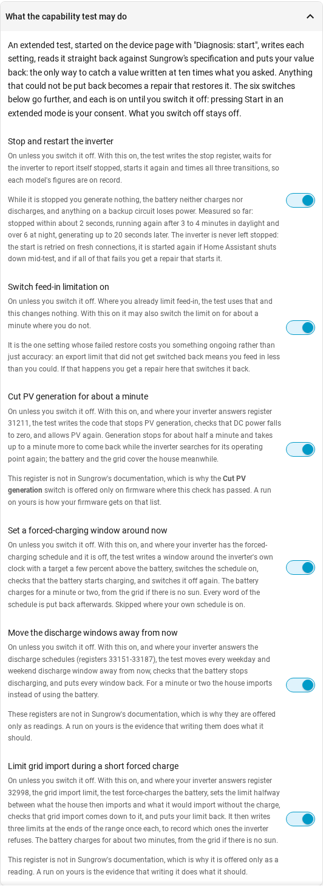

# The integration's options

Everything **Settings → Devices & services → Sungrow Modbus (preview) →
Configure** offers, with its default. The dialog explains each option in
more detail; this page is where to find one before opening it. Every
section but Polling starts collapsed, and a section you do not open stays as
it is.

The host and unit id are not here: changing them means a different device,
which is **Reconfigure** on the same page. An iHomeManager's or a Logger's
entry has no options at all, and a wallbox's own entry has its own short list
([below](#a-wallboxs-own-entry)).

## At the top

| Option | Default | What it does |
| --- | --- | --- |
| *Add this endpoint's devices now* | off | Only on an entry set up for the diagnosis. Upgrades it to a full one with entities, after asking whether to take over the YAML package's entity ids |
| *Entity IDs* | as chosen at setup | Moves the entities between the YAML package's ids and device-scoped ids, history and statistics included. The next page lists what moves before anything does. Not on a string inverter's entry: the YAML package never read one. See [integration_migration.md](integration_migration.md) |

## Polling

| Option | Default | What it does |
| --- | --- | --- |
| *Realtime group* | 5 s | Seconds between reads of each register group, 0 for never. Nothing between 1 and 4 s is offered: an inverter grants few connections, and 5 s is the YAML package's fastest |
| *Fast group* | 10 s | |
| *Medium group* | 60 s | |
| *Slowest group* | 600 s | |

## Permissions

| Option | Default | What it does |
| --- | --- | --- |
| *Start and stop the inverter* | administrators | Who may call the start and stop actions |
| *Run the capability test* | administrators | Who may start an extended test with **Diagnosis: start** |

## Another inverter on the same supply

| Option | Default | What it does |
| --- | --- | --- |
| *Power sensors for the other generation* | none | Power sensors of a non-Sungrow inverter. The Sungrow cannot see it, so its house load reads low by what that inverter makes; these correct it. Empty switches the correction off |
| *Where it is connected* | behind the same grid meter | Behind the meter, or on its own supply. It changes the arithmetic |

## Battery

| Option | Default | What it does |
| --- | --- | --- |
| *Maximum battery charge power (W)* | 0, worked out | 0 takes a Sungrow pack's limit from its datasheet, or another pack's from its BMS charge current. A value overrides both |
| *Capacity the inverter reports (kWh)* | read when the page opens | Shown for comparison, never saved. Empty where the inverter reports none, as some third-party packs do |
| *Battery capacity override (kWh)* | empty, the reported capacity | Your battery's usable capacity, for a pack that reports none or a datasheet figure you prefer. Used for the three battery charge sensors only: it never changes how a Sungrow pack is recognised or how much power you may set |

## Contribute a capability diagnosis

Answers no register can give, written into the diagnosis document. An empty
field records that it was not answered. A read-only diagnosis needs none of
them; an extended test waits until *How this inverter is connected*, *Is a
Modbus proxy in the path?* and *Is there another inverter here that is not a
Sungrow?* are answered, because what it finds can only be read against the
house it ran in. The diagnosis itself is **Diagnosis: start** on the device
page, in mode *Read-only*.

| Option | Default | What it does |
| --- | --- | --- |
| *Your name or handle* | empty, published as `anonymous` | Credited in the document |
| *How this inverter is connected* | empty | Cable, WiNet-S on Ethernet or WiFi, a Logger, or not sure. A WiNet-S answers the same either way, so only you know |
| *Is a Modbus proxy in the path?* | empty | A proxy changes what a dropped register means |
| *Anything else polling this inverter?* | empty | Another Home Assistant, the YAML package, evcc, a logger |
| *Is there another inverter here that is not a Sungrow?* | empty | A yes asks for *The other inverter* on the next page, once: its make and size, which go into the document, so no serial, address or name |
| *Battery make and model* | empty | No register reports it |
| *Anything else worth knowing* | empty | |
| *Publish the last two octets of the address* | on | Only the last two octets, never the third. Off writes `xxx.xxx` |
| *Also sweep the raw register bands (about five minutes)* | on | Also reads 2197 addresses across eighteen bands, including undocumented ones: about five minutes on a cable, longer through a WiNet-S. Off reads only the known registers, in seconds |
| *Include a raw register dump in diagnostics* | off | Not the sweep above: adds every mapped register's raw value to **Download diagnostics**. A second full read, slow through a WiNet-S |

## What the capability test may do

An extended test (**Diagnosis: start** in an extended mode) writes each
setting, reads it back against Sungrow's specification, and puts your value
back. Pressing Start is your consent; the six switches below are the parts that go further, and
**each is on until you switch it off**. Switch off what you do not want
*before* pressing the button; what you switch off stays off. With all six
off, the test still forces the battery and checks every setting's scale. A wallbox has its own test, in the options of its own entry (below).

| Option | Default | What it does |
| --- | --- | --- |
| *Stop and restart the inverter* | on | Stops it and starts it again, timing each step. 3 to 4 minutes without generation in daylight, over 6 at night; the backup output loses power meanwhile |
| *Switch feed-in limitation on* | on | Where it is off, switches it on for about a minute to test the export limit. Where it is on already, this changes nothing |
| *Cut PV generation for about a minute* | on | Where the inverter answers register 31211: cuts PV, checks DC power falls to zero, and allows it again. Needs 500 W of PV or more, so it skips itself at night. A passed check is how your firmware gets the **Cut PV generation** switch |
| *Set a forced-charging window around now* | on | Where your own forced-charging schedule is off: writes a window around the inverter's clock, checks the battery starts charging, and puts every word of the schedule back. Skips itself when the battery is full |
| *Move the discharge windows away from now* | on | Where the inverter answers the discharge schedules: moves every weekday and weekend window away from now, checks the battery stops discharging, and puts every word back. Skips itself when the battery is not discharging |
| *Limit grid import during a short forced charge* | on | Where the inverter answers register 32998 (the **Grid import limit** reading): force-charges the battery for about two minutes, sets the limit halfway between the import that causes and the import without it, checks grid import comes down to it, and puts your limit back. Then writes 0, 5001 and 5000 once each to record which the inverter refuses. Skips itself when PV covers most of the charge, or the battery is full |

Anything the test could not put back becomes a repair under **Settings →
Repairs** that restores it. The terminal diagnosis has no such switches: it
asks before writing anything, and the default is no.

### A wallbox's own entry

A wallbox with a network connection of its own is set up as an entry of its
own (**Add integration → Search my network**), read at its own address over
TLS. That is the only place it can be tested: a wallbox read through an
inverter's WiNet-S stays read only. Its options:

| Option | Default | What it does |
| --- | --- | --- |
| *Write to the wallbox while a car charges* | **off** | A wallbox an inverter manages (its EV charger in iSolarCloud) ignores writes to its own settings, so where that inverter is set up here too, the test writes the **inverter's** EV charger settings instead: user-defined mode, 6, 8 and 10 A (never above the highest current below), 5 A for the inverter to refuse, and a stop and start, watching what the car draws and putting every setting back. **A charge in progress changes current and is stopped for about 15 seconds.** A wallbox with no inverter set up here, and not declared on its own below, is not written. Runs while a car charges, every 15 minutes in *Extended test (auto repeat)* until each question has an answer |
| *No inverter manages this wallbox* | off | Your answer, never a guess: an inverter that manages the wallbox rewrites its output current within seconds. On, the test writes the wallbox's own output current, start/stop and phase settings (never the enable), reads each back, watches what the car draws and puts every value back. **A charge in progress is interrupted**: stopped and started again, the phase switched with the charge stopped first, and the wallbox left without a read for 75 seconds to see what it falls back to. It never disables the wallbox and never offers less than 6 A: both left a car not charging. What the integration saw is the `management` attribute of *Diagnosis: test summary* on the device page: `managed`, `standalone` or `unknown` |
| *Which inverter manages this wallbox?* | empty | Needed only where that inverter is set up here over its own LAN cable, which never sees the wallbox; behind a WiNet-S the inverter finds it by itself. Named here, the inverter's EV charger controls appear on its device, and the test writes that inverter's settings. Naming one and switching on the line above is refused: answer one of the two |
| *Highest charging current in the test* | empty (10 A) | Never above the wallbox's own rating. The offer above the rating and the silence test wait until you have set it: a default is not consent to them |

The rest of the page, *Your name or handle*, *Anything else worth knowing* and
*Publish the last two octets of the address*, is the inverter's diagnosis
section above, for the wallbox's own document.
