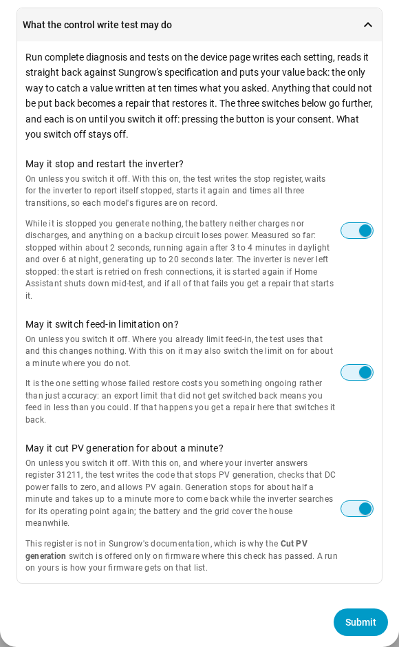

# The integration's options

Everything **Settings → Devices & services → Sungrow Modbus (preview) →
Configure** offers, with its default. The dialog explains each option in
more detail; this page is where to find one before opening it. Every
section but Polling starts collapsed, and a section you do not open stays as
it is.

The host and unit id are not here: changing them means a different device,
which is **Reconfigure** on the same page.

## At the top

| Option | Default | What it does |
| --- | --- | --- |
| *Add this endpoint's devices now* | off | Only on an entry set up for the survey. Upgrades it to a full one with entities, after asking whether to take over the YAML package's entity ids. Not offered while the preview is survey-only |
| *Entity IDs* | as chosen at setup | Moves the entities between the YAML package's ids and device-scoped ids, history and statistics included. The next page lists what moves before anything does. See [integration_migration.md](integration_migration.md) |

## Polling

| Option | Default | What it does |
| --- | --- | --- |
| *Realtime group* | 5 s | Seconds between reads of each register group, 0 for never. Nothing between 1 and 4 s is offered: an inverter grants few connections, and 5 s is the YAML package's fastest |
| *Fast group* | 10 s | |
| *Medium group* | 60 s | |
| *Slowest group* | 600 s | |

## Permissions

| Option | Default | What it does |
| --- | --- | --- |
| *Start and stop the inverter* | administrators | Who may call the start and stop actions |
| *Run the control write test* | administrators | Who may press **Run complete diagnosis and tests** |

## Another inverter on the same supply

| Option | Default | What it does |
| --- | --- | --- |
| *Power sensors for the other generation* | none | Power sensors of a non-Sungrow inverter. The Sungrow cannot see it, so its house load reads low by what that inverter makes; these correct it. Empty switches the correction off |
| *Where it is connected* | behind the same grid meter | Behind the meter, or on its own supply. It changes the arithmetic |

## Battery, wallbox and diagnostics

| Option | Default | What it does |
| --- | --- | --- |
| *Maximum battery charge power (W)* | 0, worked out | 0 takes a Sungrow pack's limit from its datasheet, or another pack's from its BMS charge current. A value overrides both |
| *Include a raw register dump in diagnostics* | off | Adds every mapped register's raw value to **Download diagnostics**. A second full read, slow through a WiNet-S |
| *Wallbox address* | empty | Only for a wallbox with its own network connection: read it there, encrypted, instead of through the WiNet-S |

## Contribute a capability survey

Answers no register can give, written into the survey document. Every field
is optional; an empty one records that it was not answered. The survey
itself is the **Run read only diagnosis** button on the device page.

| Option | Default | What it does |
| --- | --- | --- |
| *Your name or handle* | empty, published as `anonymous` | Credited in the document |
| *How this inverter is connected* | as answered at setup | Cable, WiNet-S on Ethernet or WiFi, a Logger, or not sure. A WiNet-S answers the same either way, so only you know |
| *Is a Modbus proxy in the path?* | as answered | A proxy changes what a dropped register means |
| *Anything else polling this inverter?* | empty | Another Home Assistant, the YAML package, evcc, a logger |
| *Is there another inverter here that is not a Sungrow?* | as answered | Asks for its make and size next |
| *Battery make and model* | empty | No register reports it |
| *Anything else worth knowing* | empty | |
| *May the last two octets of the address be published?* | on | Only the last two octets, never the third. Off writes `xxx.xxx` |
| *Also sweep the raw register bands* | on | Also reads 1550 addresses across twelve bands, including undocumented ones: about five minutes on a cable, longer through a WiNet-S. Off reads only the known registers, in seconds |

## What the control write test may do

**Run complete diagnosis and tests** writes each setting, reads it back
against Sungrow's specification, and puts your value back. Pressing it is
your consent; the three switches below are the parts that go further, and
**each is on until you switch it off**. Switch off what you do not want
*before* pressing the button; what you switch off stays off. With all three
off, the test still forces the battery and checks every setting's scale.

| Option | Default | What it does |
| --- | --- | --- |
| *May it stop and restart the inverter?* | on | Stops it and starts it again, timing each step. 3 to 4 minutes without generation in daylight, over 6 at night; the backup output loses power meanwhile |
| *May it switch feed-in limitation on?* | on | Where it is off, switches it on for about a minute to test the export limit. Where it is on already, this changes nothing |
| *May it cut PV generation for about a minute?* | on | Where the inverter answers register 31211: cuts PV, checks DC power falls to zero, and allows it again. Needs 500 W of PV or more, so it skips itself at night. A passed check is how your firmware gets the **Cut PV generation** switch |

Anything the test could not put back becomes a repair under **Settings →
Repairs** that restores it. The terminal survey has no such switches: it
asks before writing anything, and the default is no.
